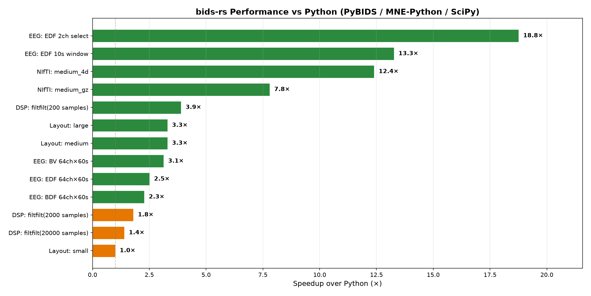
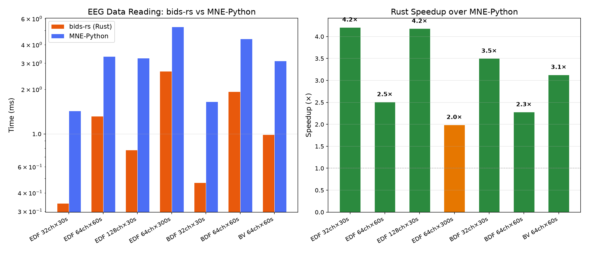
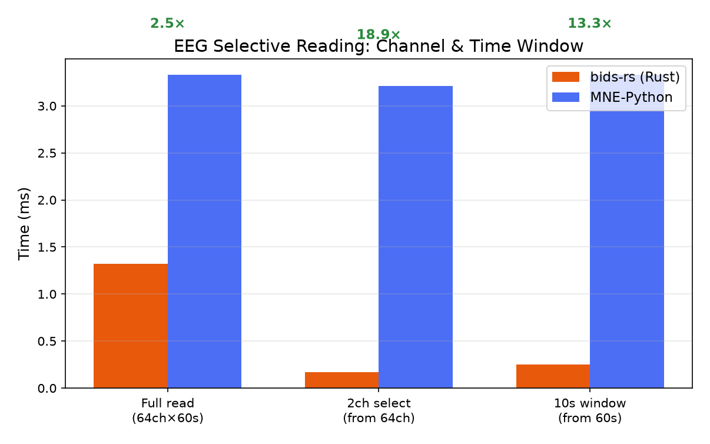
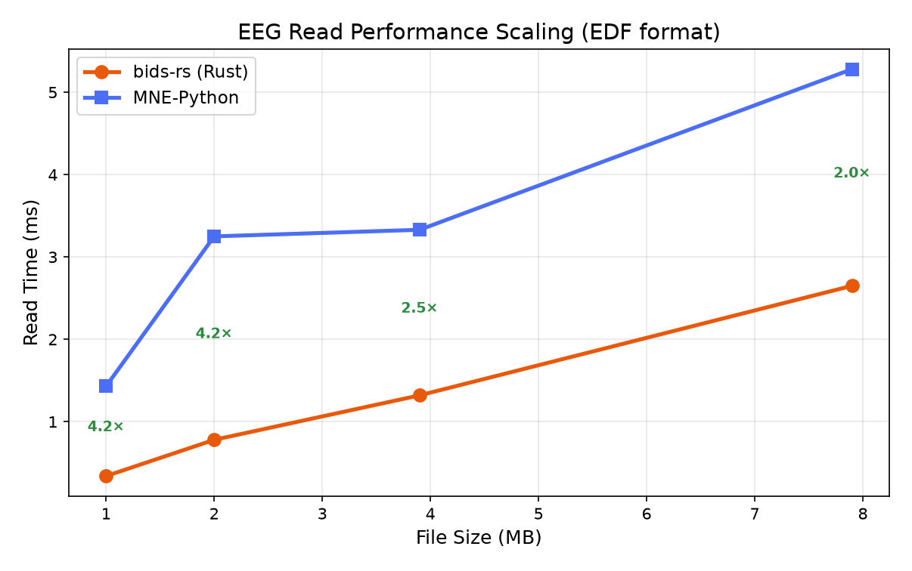
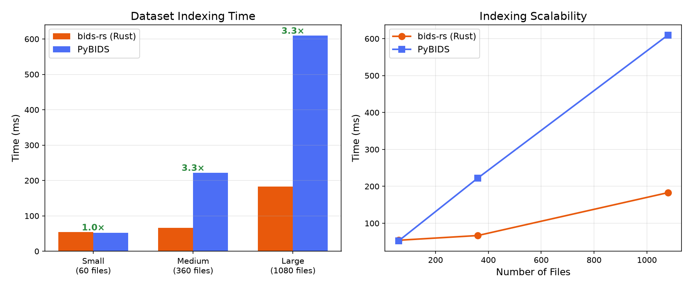

# bids

[](https://crates.io/crates/bids)
[](https://docs.rs/bids)
[](https://github.com/eugenehp/bids-rs/blob/main/LICENSE)

Comprehensive Rust tools for [BIDS (Brain Imaging Data Structure)](https://bids.neuroimaging.io/)
datasets. This is the **umbrella crate** that re-exports all `bids-*` sub-crates,
giving you a single dependency for full BIDS dataset support — indexing, querying,
validation, statistical modeling, report generation, data reading, and more.

It is the Rust equivalent of the [PyBIDS](https://github.com/bids-standard/pybids)
Python package, with first-class support for all 14 BIDS modalities (MRI, EEG, MEG,
iEEG, PET, ASL, NIRS, motion, MRS, microscopy, behavioral, and more).

## Installation

Add `bids` to your `Cargo.toml`:

```toml
[dependencies]
bids = "0.0.4"
```

### Feature Flags

All features are opt-in:

| Feature       | Description |
|---------------|-------------|
| `ndarray`     | Enable `ndarray::Array2` / `ArrayD` conversions for EEG and NIfTI data |
| `safetensors` | Enable [safetensors](https://github.com/huggingface/safetensors) export for ML frameworks (PyTorch, JAX, etc.) |
| `mmap`        | Enable memory-mapped NIfTI access (zero-copy via OS page cache using `memmap2`) |
| `arrow`       | Enable Apache Arrow / Parquet export for dataset manifests |

```toml
[dependencies]
bids = { version = "0.0.4", features = ["ndarray", "mmap"] }
```

## Quick Start

### Index and query a dataset

```rust
use bids::prelude::*;

fn main() -> bids::Result<()> {
    // Index a BIDS dataset directory
    let layout = BidsLayout::new("/path/to/bids/dataset")?;

    // Query files with a fluent API
    let bold_files = layout.get()
        .suffix("bold")
        .extension(".nii.gz")
        .subject("01")
        .collect()?;

    for f in &bold_files {
        println!("{}: {:?}", f.filename, f.entities);
    }

    // Get metadata with JSON sidecar inheritance
    let meta = layout.get_metadata(&bold_files[0].path)?;
    if let Some(tr) = meta.get_f64("RepetitionTime") {
        println!("TR: {} s", tr);
    }

    // Enumerate entities
    println!("Subjects: {:?}", layout.get_subjects()?);
    println!("Sessions: {:?}", layout.get_sessions()?);
    println!("Tasks:    {:?}", layout.get_tasks()?);

    Ok(())
}
```

### Read EEG data

```rust
use bids::prelude::*;

fn main() -> bids::Result<()> {
    let layout = BidsLayout::new("/path/to/dataset")?;
    let eeg = EegLayout::new(&layout);

    let files = eeg.get_eeg_files()?;
    let data = eeg.read_data(&files[0], &ReadOptions::default())?;

    println!("{} channels × {} samples at {} Hz",
        data.n_channels(), data.n_samples(), data.sampling_rate());

    // Z-score normalize (via the TimeSeries trait)
    let normalized = data.z_score();

    // Select channels and time windows
    let subset = data.select_channels(&["Fp1", "Fp2", "Cz"]);
    let window = data.time_slice(10.0, 20.0);

    Ok(())
}
```

### Read NIfTI images

```rust
use bids::nifti::NiftiImage;

fn main() -> bids::Result<()> {
    // Full load
    let img = NiftiImage::from_file("sub-01_bold.nii.gz".as_ref())?;
    println!("Shape: {:?}, TR: {:?}", img.shape(), img.header.tr());

    let timeseries = img.get_timeseries(32, 32, 16).unwrap();

    Ok(())
}
```

With the `mmap` feature, large files can be accessed lazily without loading
into RAM:

```rust
use bids::nifti::mmap::MmapNifti;

let nii = MmapNifti::open("big_bold.nii")?;
let vol = nii.read_volume(50)?; // decode only 1 volume
```

### Download from OpenNeuro

```rust
use bids::prelude::*;
use bids::dataset::Cache;

fn main() -> bids::Result<()> {
    let on = OpenNeuro::new();
    let cache = Cache::default(); // ~/.cache/bids-rs

    // Search datasets
    let hits = on.search().modality("eeg").limit(5).execute()?;

    // Download to local cache
    let path = on.download_to_cache(
        &hits[0].id, "1.0.0", &cache, None::<fn(&_) -> bool>,
    )?;

    // Aggregate + split for ML pipelines
    let mut agg = Aggregator::new();
    agg.add_dataset(&path, DatasetFilter::new().modality("eeg").extension(".edf"))?;
    agg.export_manifest("manifest.csv")?;
    agg.export_split("splits/", Split::ratio(0.8, 0.1, 0.1))?;

    Ok(())
}
```

### Build entity maps with the `entities!` macro

```rust
use bids::core::entities;

let ents = entities! {
    "subject" => "01",
    "task" => "rest",
    "suffix" => "eeg",
    "extension" => ".edf",
};
```

## Prelude

Import the most commonly used types in one line:

```rust
use bids::prelude::*;
// Brings in: BidsLayout, BidsFile, BidsMetadata, BidsError,
//            Config, DatasetDescription, Entity, EntityValue,
//            Entities, Result, TimeSeries, Query, QueryFilter,
//            EegLayout, EegData, ReadOptions, NiftiImage,
//            BidsReport, OpenNeuro, Aggregator, DatasetFilter, Split
```

## Crate Organization

The `bids` crate re-exports the following sub-crates:

| Module | Sub-crate | Description |
|--------|-----------|-------------|
| `bids::core` | `bids-core` | Fundamental types — `BidsFile`, `Entity`, `EntityValue`, `BidsMetadata`, `Config`, errors |
| `bids::io` | `bids-io` | TSV/JSON I/O, BIDS path building, sidecar inheritance, file writing |
| `bids::layout` | `bids-layout` | Dataset indexing, `BidsLayout`, fluent `GetBuilder` query API, DuckDB backend |
| `bids::variables` | `bids-variables` | BIDS variable system — `SimpleVariable`, `SparseRunVariable`, `DenseRunVariable` |
| `bids::modeling` | `bids-modeling` | BIDS-StatsModels — graph, nodes, contrasts, HRF convolution, transformations |
| `bids::reports` | `bids-reports` | Auto-generated publication-quality methods sections |
| `bids::validate` | `bids-validate` | Path validation, ignore/force-index patterns |
| `bids::schema` | `bids-schema` | Built-in BIDS schema for path/datatype validation |
| `bids::eeg` | `bids-eeg` | EEG — EDF/BDF/BrainVision reading, channels, electrodes, events |
| `bids::ieeg` | `bids-ieeg` | iEEG — data reading + electrode coordinate systems |
| `bids::meg` | `bids-meg` | MEG — metadata, channels, events, optional FIFF reading |
| `bids::pet` | `bids-pet` | PET — NIfTI reading, blood samples, tracer metadata |
| `bids::perf` | `bids-perf` | Perfusion ASL — NIfTI reading, ASL context, M0 scans |
| `bids::motion` | `bids-motion` | Motion capture — tracking systems, channels |
| `bids::nirs` | `bids-nirs` | fNIRS — optodes, source/detector metadata, optional SNIRF reading |
| `bids::mrs` | `bids-mrs` | MR spectroscopy — NIfTI-MRS reading, SVS/MRSI metadata |
| `bids::micr` | `bids-micr` | Microscopy — metadata, optional TIFF/OME-TIFF reading |
| `bids::beh` | `bids-beh` | Behavioral data — events and response data |
| `bids::nifti` | `bids-nifti` | NIfTI-1/NIfTI-2 reader — headers, voxels, volumes, affine, gzip, mmap |
| `bids::filter` | `bids-filter` | Signal processing — Butterworth IIR design, `lfilter`, zero-phase `filtfilt` |
| `bids::formula` | `bids-formula` | Wilkinson formula parser — interaction terms, design matrix construction |
| `bids::dataset` | `bids-dataset` | OpenNeuro integration, caching, filtering, aggregation, train/val/test splits |
| `bids::derive` | `bids-derive` | Derivatives dataset support |
| `bids::inflect` | `bids-inflect` | English singular/plural inflection for entity names |

## Benchmarks

`bids-rs` is extensively benchmarked against the Python ecosystem (PyBIDS,
MNE-Python, SciPy, nibabel). All benchmarks are reproducible via
`python3 tests/run_benchmarks.py`.

### Overall Performance



### EEG Data Reading (vs MNE-Python)

Pure-Rust EEG readers for EDF, BDF, and BrainVision formats — **2–4× faster**
than MNE-Python 1.13 for full reads, up to **19× faster** for selective
channel/time-window reads.





### EEG Read Scaling by File Size



### Dataset Indexing (vs PyBIDS)

Building a layout in-process is **2–10× faster** than PyBIDS (median 4.9×
across 19 `bids-examples` datasets), and entity queries answered from the
in-memory index are **tens of thousands of times faster** (see
[Comparison with PyBIDS](https://github.com/eugenehp/bids-rs#comparison-with-pybids)). The chart below times the
`bids` CLI end to end, so it includes process startup — about 10 ms, mostly
DuckDB's static initialisation — and shows parity on the smallest dataset.



### Summary

| Category | Avg Speedup | Range |
|----------|------------|-------|
| Layout indexing (in-process) | 5× | 2.1–9.5× |
| Layout indexing (CLI, incl. startup) | 1–3× | 1.0–3.3× |
| Entity queries | 40,000–90,000× | 6,300–574,000× |
| Filtered file queries | 4,000× | 1,000–5,300× |
| Metadata access | 84× | 25–93× |
| EEG data reading | 2–4× | 2.0–4.2× |
| EEG selective read | 13–19× | 13.3–18.8× |
| NIfTI header parsing | 7–13× | 7.3–12.6× |
| Butterworth filter design | 37–60× | 37–60× |
| filtfilt (small signals) | 1–4× | 1.4–3.9× |

> Benchmarks run on Apple M-series. Results vary by hardware. Reproduce with
> `cargo build -p bids-eeg --release --example bench_vs_python && python3 tests/run_benchmarks.py`

## Key Highlights

- **BIDS v1.9.0 specification parity** across all 14 datatypes.
- **Faster than Python** across EEG reading (2–19×), layout indexing (2–10×), and signal processing (1.4–60×).
- **HRF convolution** (SPM/Glover canonical + derivatives, FIR) validated against SciPy to <1e-10 relative error.
- **Pure-Rust signal processing** — Butterworth filter design and zero-phase `filtfilt`.
- **`#[deny(unsafe_code)]`** on all crates.
- **JSON sidecar inheritance** following the BIDS inheritance principle.
- **Common `TimeSeries` trait** for EEG, MEG, and NIRS with z-score normalization and channel statistics.

## Related Crates

- [`bids-cli`](https://crates.io/crates/bids-cli) — Command-line interface for dataset inspection, querying, reports, and OpenNeuro management.
- [`pybids-rs`](https://crates.io/crates/pybids-rs) — Python bindings via PyO3, serving as a drop-in accelerator for PyBIDS workflows.

## License

GPL-3.0-or-later — see [LICENSE](../../LICENSE) for details.
